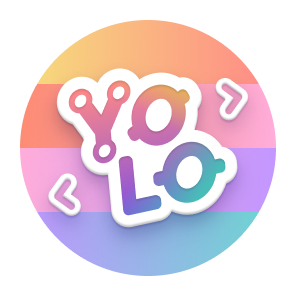

<!-- Header -->

---

### 🔥 About me

I build software that tells laser, plasma and CNC machines **where to cut**, so every sheet of metal carries as many parts as possible.

> 🇹🇷 Lazer, plazma ve CNC makineleri için sac dizme (nesting) yazılımı geliştiriyorum. Amaç: her plakadan daha çok parça, daha az fire.

---

### 🚀 Featured project

<table>
<tr>
<td width="60%">

## ✂️ Nestra

**Nesting software for laser, plasma and CNC sheet metal cutting.**
Drop in your DXF parts, Nestra arranges them on the sheet, prepares the cut and writes the machine code.

🇹🇷 *DXF parçalarını yükle; Nestra plakaya dizer, kesimi hazırlar, makine kodunu yazar.*

</td>
<td width="40%" align="center">

</td>
</tr>
</table>

---

### 🛠️ Tech stack

---

### 🏆 Achievement showcase

**YOLO** — *merged a pull request without a review* 😎
🇹🇷 *Gözden geçirme beklemeden PR birleştirdim.*

Next up / Sıradakiler: 🦈 Pull Shark · ⚡ Quickdraw · 🤝 Pair Extraordinaire · ⭐ Starstruck

---

### 🐍 Contribution snake

<picture>
  <source media="(prefers-color-scheme: dark)" srcset="https://raw.githubusercontent.com/webalet/webalet/output/github-snake-dark.svg"/>
  <source media="(prefers-color-scheme: light)" srcset="https://raw.githubusercontent.com/webalet/webalet/output/github-snake.svg"/>
  
</picture>

<!-- Footer -->

